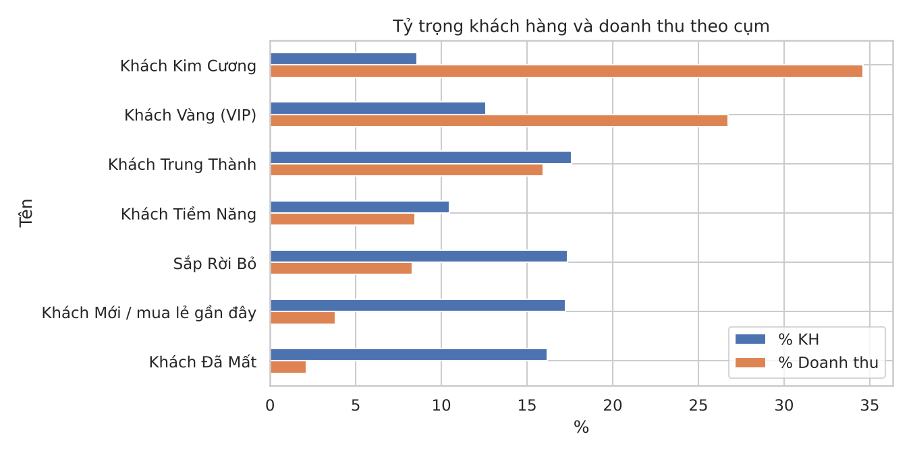

# Phân khúc khách hàng bằng RFM + K-means / Adaptive iK-means

Chia 4.275 khách hàng của một cửa hàng bán lẻ trực tuyến thành các nhóm hành vi để trả lời: nhóm nào mang lại doanh thu, nhóm nào cần kéo lại.

## 1. Vấn đề
Cửa hàng không thể chăm sóc mọi khách như nhau. Cần các phân khúc dựa trên hành vi mua thật để ưu tiên ngân sách marketing.

## 2. Dữ liệu
UCI Online Retail: 541.909 dòng giao dịch (12/2010–12/2011). Sau làm sạch còn 397.884 dòng, 4.338 khách; sau loại ngoại lai còn 4.275 khách. Cách tải: xem [`data/README.md`](data/README.md).

## 3. Phương pháp
- Làm sạch: bỏ dòng thiếu `CustomerID`, hóa đơn hủy (mã bắt đầu bằng "C"), dòng có `Quantity` hoặc `UnitPrice` ≤ 0.
- RFM: R = số ngày đến ngày tham chiếu (ngày cuối + 1), F = số hóa đơn khác nhau, M = tổng tiền.
- Loại ngoại lai F, M ở bách phân vị 99% (63 khách), rồi `ln(x+1)` và `StandardScaler`.
- So sánh K-means cơ sở (K=4) với Adaptive iK-means (tự tìm K = 7, có cắt tỉa tiểu cụm).

## 4. Phát hiện chính
Tất cả số liệu lấy từ notebook đã chạy.

| Cụm | % khách | % doanh thu |
|---|---|---|
| Kim Cương + Vàng (VIP) | 21,1 | 61,4 |
| 3 cụm cuối (mới/mua lẻ, sắp rời bỏ, đã mất) | 50,8 | 14,2 |

- Kim Cương: R trung bình 8,4 ngày, F 13,6 đơn, M 5.552 £; chiếm 34,6% doanh thu với 8,6% khách.
- K-means (K=4) có silhouette 0,3329; iK-means (K=7) có 0,2778. iK-means chia mịn hơn nhưng chỉ số tách cụm hình học thấp hơn, đây là đánh đổi.
- K-means K=4 ổn định giữa các seed (ARI trung bình 0,997 qua 10 seed).



## 5. Hành động đề xuất
- Hai cụm đầu: chăm sóc ưu tiên, ưu đãi mua sớm.
- Cụm R lớn, F nhỏ: chiến dịch kéo khách quay lại.
- Cụm mua lẻ gần đây: khuyến khích đơn thứ hai.

## Hạn chế
Dữ liệu một cửa hàng; RFM không dùng thông tin sản phẩm; số cụm phụ thuộc ngưỡng cắt tỉa (3% và 35%); tên cụm chỉ là nhãn gợi ý.

## Cách chạy
```bash
pip install -r requirements.txt
# đặt data/Online Retail.xlsx (xem data/README.md)
jupyter nbconvert --to notebook --execute --inplace notebooks/01_rfm_kmeans.ipynb
```

## Về việc dùng AI
Đồ án gốc là bài làm môn học của tác giả. Notebook này được sắp xếp lại và viết lại từ code đồ án với sự hỗ trợ của Claude (Anthropic); số liệu được chạy lại trên dữ liệu thật và đối chiếu với báo cáo.
